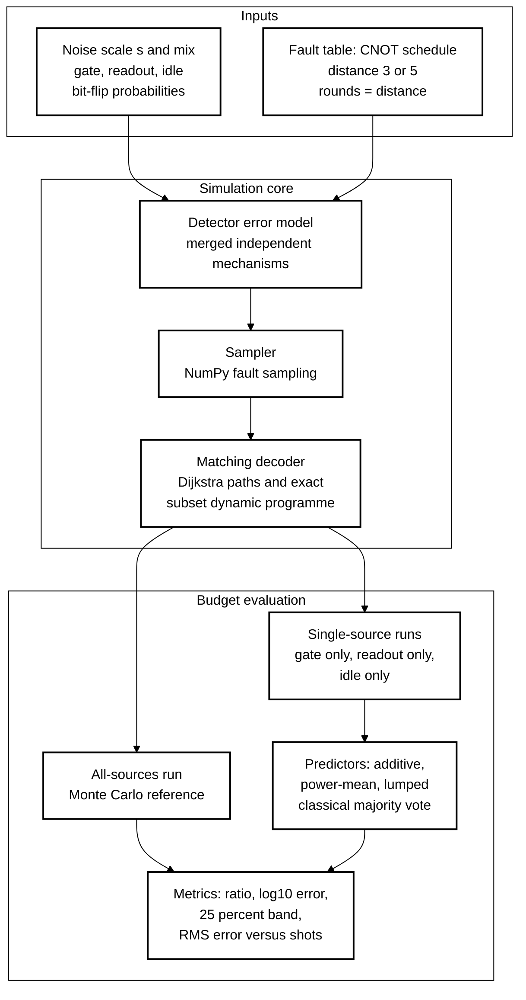
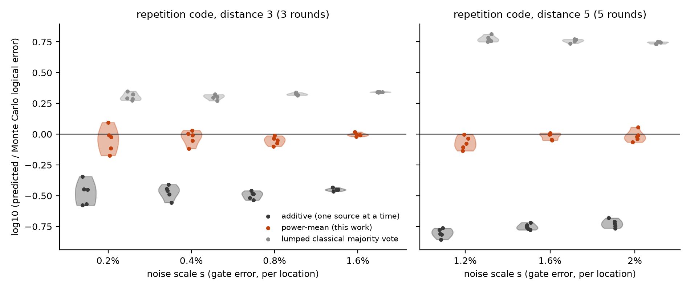
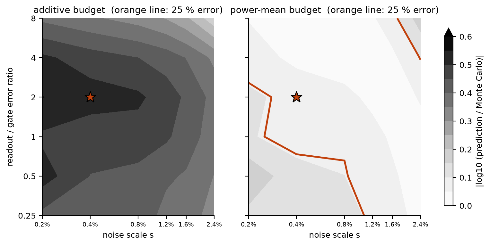
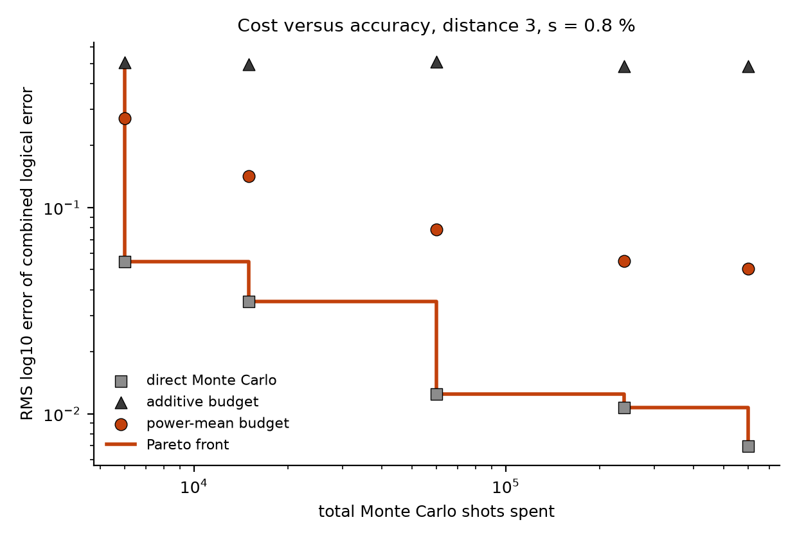
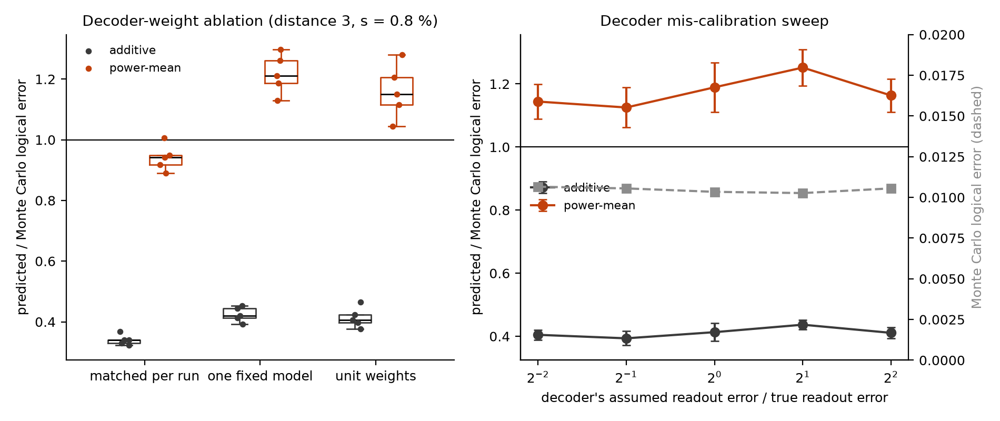
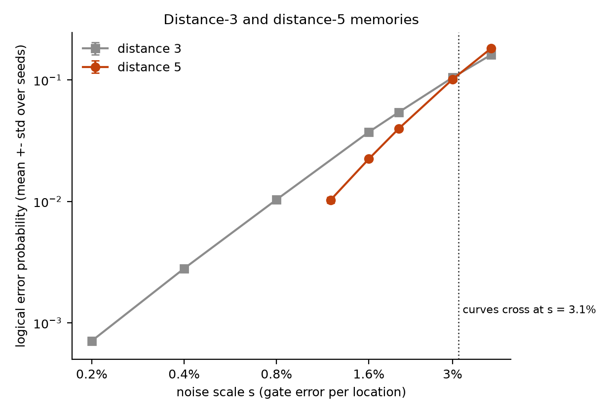

# Power-Mean Error Budgets for a Circuit-Level Repetition-Code Memory

[](LICENSE)
[](pyproject.toml)
[](https://github.com/pradeepdegalaroyal/power-mean-error-budget-repetition-code-memory/actions/workflows/ci.yml)

## Abstract

Quantum error correction (QEC) experiments attribute logical errors to noise sources by switching all sources off but one, and then summing the single-source rates. For a distance-*d* repetition-code memory with gate, readout and idle bit-flip noise, this additive budget under-predicts the combined logical error by a factor of about 3 (distance 3) and 5 to 6 (distance 5), while a power-mean budget, (Σ ε<sub>s</sub><sup>1/*t*</sup>)<sup>*t*</sup> with *t* = (*d* + 1)/2, lands within 0.86 to 0.99 of direct Monte Carlo at all seven operating points tested (5 seeds each). A single calibration extrapolates to 30 of 36 noise-scale and readout-ratio cells within ±25 %, but the budget is decoder-dependent and never beats direct simulation of the combined noise on cost, so the hypothesis that it is cheaper is rejected. All results are classical simulation.

## Motivation

Recent superconducting-qubit experiments explain logical performance by ranking noise sources: measurement noise dominates logical-gate failure and idling during readout is highly detrimental to a memory (Harper et al., 2026, digital object identifier (DOI) 10.1038/s41467-026-71773-6), and logical error falls with the number of decoding rounds in a real-time stability experiment (Caune et al., 2026, DOI 10.1038/s41467-026-73331-6). Ranking is not budgeting: a budget must also say what the *total* is when the sources act together. Because a distance-*d* code needs at least *t* = (*d* + 1)/2 faults to fail, the total is a degree-*t* polynomial in the source rates, and a plain sum of single-source rates omits all mixed terms.

## Research gap

The supplied literature gives source rankings (Harper et al., 2026), threshold shifts from decoder modelling (Rispler et al., 2026, DOI 10.1038/s41534-026-01271-6), decoders for other noise types (Kuo and Ouyang, 2026, DOI 10.1038/s41534-026-01212-3), and memory baselines with matching decoders (Kelly et al., 2015, DOI 10.1038/nature14270; Krinner et al., 2022, DOI 10.1038/s41586-022-04566-8). None gives a tested rule for combining per-source logical errors, a map of where it holds, or its sensitivity to decoder calibration and simulation cost. The related-work table and the derivation are in [`docs/RESEARCH_GAP.md`](docs/RESEARCH_GAP.md); the design is in [`docs/METHOD.md`](docs/METHOD.md).

## What is new here

* A testable combination rule, the power-mean budget, scored against the additive budget, a lumped classical majority-vote model and direct Monte Carlo, with the minimum fault weight *t* as the only structural input.
* A validity map: one single-source calibration is rescaled over noise scale and readout-to-gate ratio and compared with simulation in every cell.
* Ablations and sweeps that were not part of the cited experiments: decoder weights, the exponent, decoder mis-calibration, and a cost-versus-accuracy front. One hypothesis fails (Claim 3).

## Hypotheses

1. **Hypothesis 1.** At one operating point the additive budget under-predicts the combined logical error by a factor that grows with *t*; the power-mean budget is within ±25 %.
2. **Hypothesis 2.** One calibration extrapolates across noise scale and readout ratio by rescaling.
3. **Hypothesis 3.** At equal Monte Carlo cost the power-mean budget is on the cost-versus-error Pareto front.

## Method



Legend: CNOT = controlled-NOT gate; RMS = root-mean-square.

**System.** A bit-flip repetition code with *d* ∈ {3, 5} data qubits and *d* rounds of syndrome extraction (two CNOT layers, an idle period, ancilla readout), then a final data readout. Three bit-flip sources: gate (both outputs of each CNOT), readout, idle. Default mix: gate *s*, readout 2*s*, idle *s*. Faults are single-qubit X errors, so fault effects are propagated exactly into a detector error model (DEM) and sampled in NumPy; no stabiliser-simulation package is used. The decoder is minimum-weight matching with log-likelihood weights.

**Budgets.** With ε<sub>s</sub> the logical error with only source *s* on: additive Σ ε<sub>s</sub>; power-mean (Σ ε<sub>s</sub><sup>1/*t*</sup>)<sup>*t*</sup>; lumped classical majority vote over *d* bits with per-bit flip probability rounds·(idle + 2·gate) + readout. The reference is direct Monte Carlo with the full noise.

## Results

All numbers below are read from [`results/`](results/) (`summary.json` and the tables it is computed from). "Ratio" is prediction divided by Monte Carlo, mean ± standard deviation over 5 seeds (100 000 shots per run for distance 3, 60 000 for distance 5).

| Distance | Noise scale s | Logical error, all sources | Additive ratio | Power-mean ratio | Lumped classical ratio |
|---|---|---|---|---|---|
| 3 | 0.2 % | 0.071 ± 0.005 % | 0.34 ± 0.08 | 0.92 ± 0.22 | 2.02 ± 0.14 |
| 3 | 0.4 % | 0.280 ± 0.013 % | 0.34 ± 0.04 | 0.94 ± 0.12 | 2.01 ± 0.09 |
| 3 | 0.8 % | 1.034 ± 0.022 % | 0.32 ± 0.02 | 0.89 ± 0.07 | 2.11 ± 0.04 |
| 3 | 1.6 % | 3.732 ± 0.024 % | 0.36 ± 0.01 | 0.99 ± 0.03 | 2.20 ± 0.01 |
| 5 | 1.2 % | 1.026 ± 0.058 % | 0.16 ± 0.01 | 0.86 ± 0.11 | 5.96 ± 0.35 |
| 5 | 1.6 % | 2.239 ± 0.070 % | 0.18 ± 0.01 | 0.96 ± 0.06 | 5.72 ± 0.18 |
| 5 | 2.0 % | 3.979 ± 0.068 % | 0.19 ± 0.01 | 0.97 ± 0.11 | 5.53 ± 0.09 |

Across all seeds the median absolute log10 error is 0.034 for the power-mean budget, 0.555 for the additive budget and 0.343 for the lumped classical model.

### Claim 1: the additive budget under-predicts by a factor that grows with *t*; the power-mean budget does not



*Figure 1. The additive budget sits at about one third (distance 3, t = 2) and one sixth (distance 5, t = 3) of the simulated value; the power-mean budget sits on the zero line.* Pooled over the seven points, the power-mean ratio is 0.86 to 0.99, inside the ±25 % criterion of Hypothesis 1. Exponent ablation (`results/exponent_ablation.csv`): root-mean-square log10 error is 0.47 (*t* = 1, additive), 0.033 (*t* = 2) and 0.019 (fitted *t* = 2.05) at distance 3, and 0.76, 0.040 and 0.026 (fitted *t* = 3.08) at distance 5, so the theory value of *t* is close to the best fit. *Caveat:* the power-mean budget is slightly low on average (mean log10 error −0.033), and distance 5 could only be tested at 1.2 to 2 % because single-source events are too rare below that, so this is not the deep sub-threshold regime of hardware.

### Claim 2: one calibration extrapolates over most of the noise plane, and fails at its corners



*Figure 2. The star marks the single calibration point (s = 0.4 %, readout/gate ratio 2); the orange line bounds the region where the power-mean budget is off by more than 25 %, and the additive budget is off by more than 25 % everywhere.* Of 36 cells, 30 (83 %) of the power-mean extrapolations are within ±25 % (14 of 18 cells at s ≤ 0.8 %), against 0 of 36 for the additive budget; the power-mean budget is the more accurate one in 97 % of cells. Hypothesis 2 is supported in the interior. *Caveat:* the power-mean budget under-predicts by up to 35 % at the lowest noise (ratio 0.65 at s = 0.2 %, readout ratio 0.5) and over-predicts by 50 % at s = 2.4 % with readout ratio 8, where the polynomial scaling around the calibration point breaks down; the distance-3 and distance-5 curves cross at s = 3.1 % (Figure 5), so the upper corner is close to threshold.

### Claim 3: the budget depends on decoder calibration and does not beat direct simulation on cost



*Figure 3. At every shot budget direct Monte Carlo has lower error than the power-mean budget, so the Pareto front (orange) consists only of direct simulation.* At 6 000 total shots the root-mean-square log10 error is 0.055 for direct Monte Carlo against 0.271 for the power-mean budget and 0.505 for the additive budget; at 600 000 shots it is 0.007, 0.051 and 0.486. **Hypothesis 3 is rejected** at distance 3 and s = 0.8 %, where the combined error is about 1 % and events are not rare.



*Figure 4. Left: the power-mean ratio leaves 1 when the matching weights are not re-derived for each single-source run. Right: a decoder that mis-states the readout probability by a factor of 4 in either direction changes the simulated logical error only from 1.03 % to 1.07 %.* With one fixed full-noise decoder the power-mean ratio is 1.22 ± 0.07 (distance 3) and 1.51 ± 0.07 (distance 5); with unit weights 1.16 ± 0.09 and 1.41 ± 0.07; with weights matched per run 0.94 ± 0.04 and 0.96 ± 0.07. The unit-weight decoder raises the simulated logical error from 1.04 ± 0.04 % to 1.37 ± 0.03 % at distance 3 and from 2.23 ± 0.03 % to 2.95 ± 0.09 % at distance 5.



*Figure 5. The two memories cross at s = 3.1 %, which for this mix is a gate error of 3.1 % and a readout error of 6.3 %.*

## Discussion

The additive budget is wrong by construction in the sub-threshold regime: with *t* faults needed, mixed fault sets dominate, and the missing factor grows from about 3 to about 6 as *t* goes from 2 to 3. Combining the single-source rates through their 1/*t* powers repairs this without extra parameters, and the fitted exponents (2.05 and 3.08) agree with theory. The same data show where the repair is incomplete: it is not a bound (ratios above 1 occur at high noise), and it is tied to how the single-source runs are decoded. Re-deriving the matching weights for each single-source run, which a simulation can do but hardware cannot, matters more than the exponent: a fixed decoder inflates every single-source rate and the budget then over-predicts by 22 % to 51 %. Gate noise is the largest single-source term here (for example 0.200 % of 1.034 % at distance 3, s = 0.8 %, against 0.075 % for readout, `results/budget_accuracy.csv`), unlike the readout-dominated logic reported on hardware; this reflects my two-layer CNOT schedule and the 2:1 readout mix, not a finding about devices. The lumped classical majority-vote model is off by a factor of 2 (distance 3) to 6 (distance 5) because it ignores syndrome-measurement noise. Direct simulation wins on cost in the tested regime; a budget can only pay off where the combined event is too rare to sample, which I did not test.

## Limitations

* Bit-flip noise on a repetition code only: no Y or Z errors, no correlated errors, no leakage, ideal reset, and no hyperedge decomposition.
* Distance 3 and 5 only; at distance 7 and below 1 % the single-source rates are too small to measure with the shots used.
* Distance 5 and the cost study sit near 1 to 4 % noise, close to the 3.1 % crossing; hardware operates around 0.1 to 1 %.
* The ±25 % tolerance is a choice; the power-mean budget is not a rigorous bound.
* Classical simulation only; the full run takes about 16 minutes (982 s), slightly above a 15-minute compute target.

## Future work

* Replace the repetition code by the surface code and use a detector error model with hyperedges from a circuit-level simulator, to test whether *t* alone keeps the exponent correct when mixed fault sets include Y errors.
* Test the rare-event regime (distance 7 and above at 0.1 % noise), where single-source rates are tiny but the budget may still be cheaper than direct sampling; this is a hypothesis, not a result of this study.
* On hardware, single sources cannot be switched off; the single-source rates would come from a device-calibrated noise model, so the next question is how errors in that model propagate through the 1/*t* power.
* Add the decoder's own latency and backlog to the budget (Caune et al., 2026).

## Reproducibility

```bash
pip install -r requirements.txt
python -m pytest -q                       # 10 tests, about 2 s
python experiments/run_all.py --quick     # smoke run, about 17 s, writes to a temporary folder
python experiments/run_all.py             # full study, 982 s, writes results/ and figures/
python experiments/make_figures.py        # redraw figures from results/ only
```

Hardware: Windows 11 laptop, Python 3.11.9, 16 central-processing-unit threads (NumPy; no graphics processing unit). Seeds 0 to 4 (0 to 2 for the validity map) with NumPy `SeedSequence` streams keyed by experiment and parameters. Per-stage runtimes are in `results/summary.json`. Pinned versions are in `requirements.txt`.

## Project structure

```
src/qec_error_budget/   circuit.py (fault table), dem.py (detector error model, sampler),
                        decoder.py (matching), budget.py (predictors), simulate.py,
                        studies.py (experiments), summary.py, plots.py
experiments/            run_all.py, make_figures.py
tests/                  test_core.py
docs/                   RESEARCH_GAP.md, METHOD.md
results/                raw tables (comma-separated values) and summary.json
figures/                fig1 to fig5
.github/workflows/      ci.yml
```

## Related work by the author

* [repetition-code-breakeven-map](https://github.com/pradeepdegalaroyal/repetition-code-breakeven-map): break-even margin of a bit-flip repetition-code memory over an idling qubit versus cycle time, readout and gate error, with an exact space-time decoder.
* [imperfect-erasure-flag-decoding-toric-code](https://github.com/pradeepdegalaroyal/imperfect-erasure-flag-decoding-toric-code): cost of imperfect erasure-flag efficiency for matching decoding of the toric code.

## Citation

```bibtex
@software{degala_power_mean_error_budget_2026,
  author   = {Degala, Chenchupradeep},
  title    = {Power-Mean Error Budgets for a Circuit-Level Repetition-Code Memory},
  year     = {2026},
  version  = {0.1.0},
  url      = {https://github.com/pradeepdegalaroyal/power-mean-error-budget-repetition-code-memory},
  license  = {MIT}
}
```

MIT license (`LICENSE`). Machine-readable citation metadata: `CITATION.cff`.
